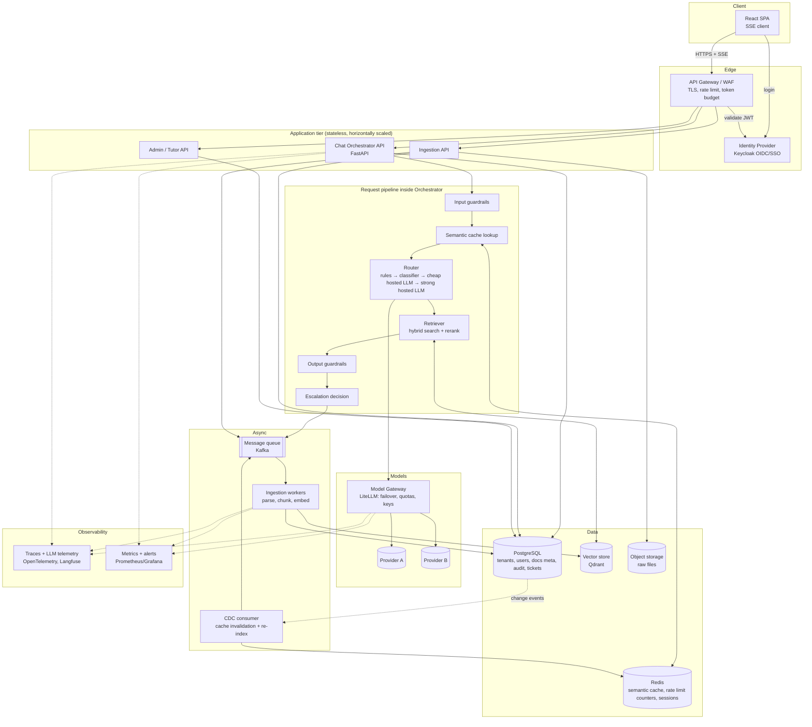

# High-Level Design (HLD) — StudyBuddy (enterprise edition)

> Scope of an HLD: **components, their responsibilities, how they talk, and why** — not classes,
> schemas or code (that is the LLD, written per component afterwards).
> Numbers come from `docs/stage-00-requirements.md`. Treat them as the design budget.

## 1. Context
StudyBuddy is a multi-tenant SaaS: universities (**tenants**) upload course notes; students ask
questions answered *only* from those notes, with citations. Enterprise means we design for:
multi-tenancy & data isolation, SSO, audit, SLOs, cost governance, and failure of any dependency.

**Actors:** Student, Instructor, Tenant Admin, Human Tutor (escalation), Platform Operator (us).

## 2. Architecture diagram

## 3. Components & responsibilities

| # | Component | Responsibility | Video concept |
|---|---|---|---|
| 1 | React SPA | Chat UI, upload UI, streaming render | SSE streaming |
| 2 | Identity Provider | SSO, OIDC, roles (student/instructor/admin), tenant claim in JWT | Auth module |
| 3 | API Gateway/WAF | TLS, DoS protection, per-user/tenant rate limit, token budgets | Gateway & rate limiting |
| 4 | Chat Orchestrator | Runs the request pipeline; owns conversation state | Core service |
| 5 | Input guardrails | Prompt-injection & PII checks before anything costs money | Guardrails |
| 6 | Semantic cache | Return stored answer for near-duplicate questions (tenant-scoped) | Semantic caching |
| 7 | Router | Decide cheapest sufficient handler and whether retrieval is needed (rule → classifier → cheap hosted LLM → strong hosted LLM) | Minimum sufficient intelligence |
| 8 | Retriever | Hybrid (BM25+vector) search with tenant filter, rerank, citations | RAG |
| 9 | Output guardrails | Groundedness check, PII scrub, policy filter | Guardrails |
| 10 | Escalation (HITL) | Low confidence / sensitive topic → ticket for human tutor | HITL |
| 11 | Model Gateway | Provider abstraction, failover, retries, central keys/quotas | AI gateway |
| 12 | Message queue (Kafka) | Buffer spikes; decouple ingestion & escalations | Queuing/throttling |
| 13 | Ingestion workers | Parse → chunk → embed → upsert; idempotent | Async/long tasks |
| 14 | CDC consumer | On doc change: invalidate cache entries, re-index affected chunks | CDC & freshness |
| 15 | Data stores | Postgres (truth), Qdrant (vectors), Redis (hot), S3-style (files) | — |
| 16 | Observability | Traces, P95/P99, cost per tenant, quality evals, alerts | Telemetry |

## 4. Key flows

**A. Ask a question (hot path, target first token < 1.5 s)**
1. SPA → Gateway (JWT checked, rate/budget check) → Orchestrator.
2. Input guardrails → cache lookup (tenant-scoped). **Hit → stream cached answer, done.**
3. Router classifies: greeting/FAQ via rules (no retrieval, no LLM), intent via classifier, else picks an LLM tier by complexity.
4. Only if the route needs course notes: Retriever fetches top-k chunks (tenant + course filter mandatory) → the chosen model via Model Gateway (streamed).
5. Output guardrails on the stream; low confidence/sensitive → escalation path.
6. Store answer in cache (with source-doc version tags); emit trace + cost.

**B. Upload notes (async)** Upload → object store → queue → worker parse/chunk/embed → vector upsert →
Postgres doc version bump → CDC event → cache entries tagged with that doc are invalidated.

**C. Escalation** Pipeline flags → ticket in Postgres + queue event → tutor UI → human reply is returned
to the student and can be added to the cache/FAQ.

## 5. Cross-cutting design decisions (ADR-lite)
| ID | Decision | Alternatives | Why / trade-off |
|---|---|---|---|
| ADR-1 | Modular monolith for app tier (Orchestrator/Ingestion/Admin as separate deployables sharing a library) | Full microservices | Team of one/few; split only where scaling differs (ingestion vs chat) |
| ADR-2 | Tenant isolation via `tenant_id` filter enforced in a data-access layer + vector payload filters | DB-per-tenant | Cheaper; risk of leak → needs tests & audit. Revisit for regulated tenants |
| ADR-3 | Postgres is source of truth; Redis/Qdrant are rebuildable | Vector DB as truth | Lets us recover/re-embed on model change |
| ADR-4 | All LLM calls go through Model Gateway | Direct SDK calls | One place for failover, budgets, logging |
| ADR-5 | SSE not WebSockets | WebSocket | One-way token stream, simpler through proxies/LB |
| ADR-6 | Queue for anything slow or spiky; hot path never blocks on it | Sync everywhere | Protects P95 |
| ADR-7 | Cache keyed by (tenant, embedding similarity ≥ threshold, doc-version tags) | Exact-match cache | Higher hit rate; threshold risk = wrong answers (tune with evals) |

## 6. Non-functional mapping
- **Scalability:** stateless app tier behind LB; scale workers on queue depth; Qdrant/Redis sharded later.
- **Availability:** multi-AZ; model failover; degrade gracefully (cache-only / "try again" / escalate) when LLMs are down.
- **Security:** OIDC, least-privilege roles, tenant isolation, secrets only in gateway, audit log, PII redaction in logs.
- **Cost:** cache → router → budgets; per-tenant cost dashboards.
- **Observability:** one trace id from gateway to model; SLO alerts on P95, error rate, cost/day, groundedness.

## 7. Failure modes to design for (we will test these)
LLM provider outage · vector DB slow · Redis down (bypass cache) · queue backlog · poisoned/injected document
in notes · cache serving stale answer after edit · one tenant exhausting budget · cross-tenant retrieval leak.

## 8. LLD order (next docs, one per component)
1. Data model & tenancy · 2. Auth/roles · 3. Gateway & rate limiting · 4. Orchestrator pipeline contracts ·
5. Ingestion & chunking · 6. Retriever · 7. Semantic cache + CDC · 8. Router · 9. Guardrails ·
10. Model gateway · 11. Escalation · 12. Observability · 13. Frontend/SSE.

## 9. Decisions for you
1. **Multi-tenancy:** keep shared-DB + `tenant_id` (ADR-2), or do you want to learn the harder DB-per-tenant model?
2. **Queue:** Kafka (decided). Trade-off to learn: powerful (replay, partitions, ordering) but heavier to run than RabbitMQ.
3. ~~Self-hosted small model~~ — removed (decided): both model tiers are hosted APIs behind the Model Gateway.
4. Which component's LLD should we do first? (Suggest: #1 data model, since everything depends on it.)
