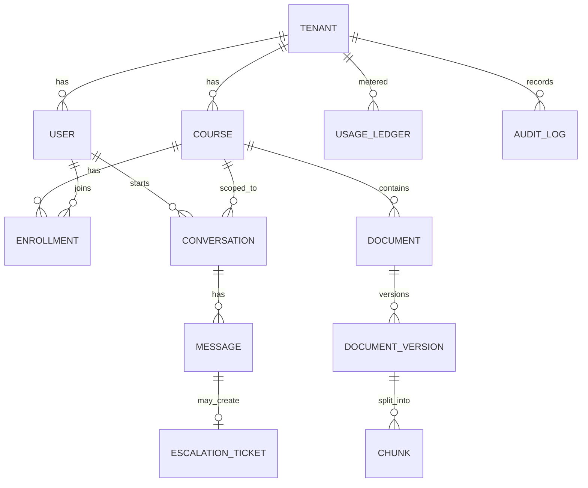

# LLD 01 — Data model & tenancy

Why first: every component reads/writes these entities, and tenant isolation is the one mistake
we cannot afford. Assumes HLD ADR-2 (shared DB, `tenant_id` on every row) — change it if you decide otherwise.

## 1. Design principles
1. **Every tenant-owned row has `tenant_id NOT NULL`**, and it is part of every index and FK.
2. **Isolation is enforced by the database, not by developer discipline:** Postgres Row-Level Security (RLS).
3. **Postgres is truth; Redis/Qdrant are rebuildable** (ADR-3). Anything in them must be derivable from Postgres + object storage.
4. **Append-only where it matters:** audit log and document versions are never updated in place.
5. IDs are UUIDv7 (time-sortable, safe to expose, no enumeration).

## 2. Entities (Postgres)

| Table | Key columns | Notes |
|---|---|---|
| `tenant` | id, name, status, plan, monthly_token_budget, eval_retention (bool) | Budget feeds gateway limits (LLD 03) |
| `app_user` | id, tenant_id, idp_subject, role (`student/instructor/admin/tutor`), status | `idp_subject` = OIDC `sub`; no passwords stored |
| `course` | id, tenant_id, title, term | Unit of access control and of retrieval scope |
| `enrollment` | tenant_id, course_id, user_id, role_in_course | Decides who can ask about which course |
| `document` | id, tenant_id, course_id, title, current_version_id, status | Logical file |
| `document_version` | id, tenant_id, document_id, version_no, object_key, sha256, status (`uploaded/processing/ready/failed`) | Immutable; sha256 dedupes re-uploads |
| `chunk` | id, tenant_id, version_id, ordinal, text, token_count, embedding_model | Text kept here so vectors can be rebuilt |
| `conversation` | id, tenant_id, user_id, course_id, created_at | One course per conversation (D1) |
| `message_raw` | id, tenant_id, message_id, content, expires_at | Only written if tenant `eval_retention=true` (D2); separate table, stricter grants, short TTL |
| `message` | id, tenant_id, conversation_id, role, content_redacted, raw_content_id (nullable), route (`cache/rule/small/large/human`), model, cited_chunk_ids[], tokens_in/out, cost_usd, latency_ms, trace_id | The telemetry row per answer |
| `escalation_ticket` | id, tenant_id, message_id, reason, status, assigned_tutor_id, resolution | HITL |
| `usage_ledger` | tenant_id, user_id, day, tokens_in, tokens_out, cost_usd | Aggregated; source for budgets |
| `audit_log` | id, tenant_id, actor_id, action, target, at, ip | Append-only, no UPDATE/DELETE grants |
| `outbox_event` | id, tenant_id, type, payload, created_at, published_at | Transactional outbox → queue/CDC (LLD 07) |

## 3. Tenant isolation: three layers
1. **Postgres RLS:** `ALTER TABLE x ENABLE RLS; POLICY USING (tenant_id = current_setting('app.tenant_id')::uuid)`.
   App connects as a non-owner role; each request does `SET LOCAL app.tenant_id = <jwt tenant claim>` in its transaction.
2. **Vector store:** every point carries `tenant_id` + `course_id` payload; the retriever API *cannot be called without*
   a `tenant_id` and a single `course_id` filter (wrapper rejects it otherwise).
   Qdrant payload index on both fields.
3. **Cache:** key namespace `t:{tenant_id}:c:{course_id}:...` so a lookup can never cross tenants or courses by construction.

### 3a. Course scoping (D1)
Each request is for exactly one course. The API checks the user is enrolled in `course_id` (an `enrollment` lookup, cached briefly in Redis)
before anything else; the same `course_id` then drives the vector filter and the cache key. No entitlement sets or per-hit checks are needed.
Future option (not built): cross-course search would need an entitlement-set filter and cache hits verified against it. Skipped to keep v1 simple.

**Mandatory test:** two tenants with identical documents; assert a tenant-A user can never retrieve, cache-hit or read tenant-B data
via API, vector search or cache (we add this as an automated test in the first coding stage).

## 4. Non-Postgres data
| Store | Content | Key / structure | Rebuild from |
|---|---|---|---|
| Object storage | raw uploads | `{tenant}/{course}/{doc}/{version}/{filename}` | — (truth for files) |
| Qdrant | one collection `chunks_v{embedding_model_version}` | point id = chunk id; payload tenant/course/doc/version | `chunk` table (re-embed) |
| Redis | semantic cache, rate counters, session | see LLD 03/07 | not needed |

Versioned collection name lets us swap embedding models by building a new collection and flipping an alias (zero downtime).

## 5. Retention & privacy
- Messages store **redacted** content (PII scrubbed before persist) by default; raw content never goes to general logs.
- **Raw chat for quality evaluation (D2):** only if the tenant opts in (`eval_retention`). Stored in `message_raw` (separate grants: only the eval job/role can read), TTL 30 days, excluded from backups beyond TTL where feasible, and tenants can purge on request. Evaluators see it via a sampled export, never via the app API.
- Conversation retention default 180 days per tenant policy; hard-delete job + delete vectors/cache on user/doc removal (GDPR-style).
- Audit log retained 1 year, partitioned monthly.

## 6. Scaling notes
- Partition `message`, `audit_log`, `usage_ledger` by month.
- Index on `(tenant_id, conversation_id, created_at)`; never an index without `tenant_id` leading.
- Read replicas for tutor dashboards/analytics; hot path reads only primary/cache.

## 7. Trade-offs to understand
| Choice | Gain | Cost / risk |
|---|---|---|
| Shared DB + RLS | cheap, simple ops, easy cross-tenant admin | noisy neighbor; a policy bug leaks data → tests + least-privileged role |
| Chunk text in Postgres | rebuildable vectors, easy debugging | storage duplication |
| Outbox pattern | no lost events (DB write + event atomic) | extra table + relay process |
| UUIDv7 | index-friendly, non-guessable | 16 bytes vs 8 |

## 8. Decisions (resolved)
| # | Question | Decision | Consequence |
|---|---|---|---|
| D1 | Retrieval scope | One course per conversation/question (cross-course deferred) | Simple filter and cache key; user picks a course in the UI |
| D2 | Raw chat content | Keep for evaluation, opt-in per tenant, short TTL, separate table | `message_raw`, restricted role, purge job |
| D3 | Primary isolation | Shared DB + `tenant_id` + Postgres RLS | Three-layer isolation, mandatory leak tests |

| D4 | Who reads raw chats / messages | Only the tutor assigned to a specific `escalation_ticket`, and only that conversation | RLS policy on `message`/`message_raw` joins to `escalation_ticket.assigned_tutor_id`; every read is audit-logged |
