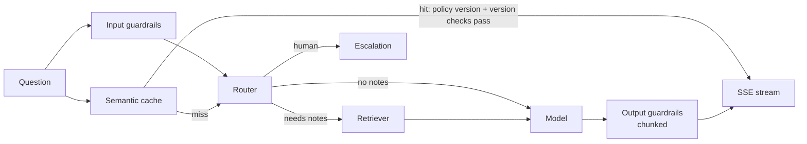

# LLD 03 — Chat Orchestrator pipeline

Depends on: LLD 01 (data model, tenancy), LLD 02 (auth). Written after a step-by-step walkthrough (Steps 1–7).
The orchestrator runs one question through a fixed pipeline of stages and streams the answer back.

## 1. The pipeline (Step 1)

Each stage inspects the request and decides one of: **continue**, **stop with an answer** (e.g. cache hit),
**stop with a refusal** (e.g. guardrail block), or (router) **escalate to a human**.
Stages are independent: each can be built, tested and replaced without touching the others.

## 2. Request context (Step 2)
One object created at request start and passed through every stage.

| Group | Fields | Notes |
|---|---|---|
| Identity | tenant_id, user_id, role | From the verified JWT (via trusted gateway headers) only, set once, read-only afterwards |
| Limits | budget_state (`ok/warning/soft_limit/hard_limit`) | Supplied by the gateway (LLD 09 A4); the router must use only the cheap tier at `soft_limit` |
| Scope | course_id | Enrollment verified once at start (LLD 01 §3a) |
| Input | question, request_id | request_id is client-generated (idempotency) |
| Tracking | trace_id, started_at, per-stage timings | |
| Results so far | guardrail_result, cache_result, route, rewritten_query, chunks, retrieval_confidence, answer, tokens_in/out, cost, policy/prompt/router versions | Each stage writes its own findings; later stages read them |

Why one shared object: one lookup instead of many (speed), tenant id cannot drift between stages (safety), the final
context is a complete debugging record.

## 3. Stage contract
Every stage: `run(context) -> decision`. Decisions are typed:
- Input guardrails → `allow | block(reason) | allow_with_redactions`
- Cache → `hit(answer, source_doc_versions) | miss`
- Router → `route(rule | cheap_llm | strong_llm | human, needs_retrieval)`
- Retriever → `chunks[] | none_found | error`
- Output guardrails (per chunk) → `pass | redact | block`
The orchestrator only reads decisions, never stage internals. Replacing a regex guardrail with a model-based one changes
only that stage.

## 4. Failure handling: required vs optional (Step 3)
Each stage has a flag. Rule: **optional stages fail open; safety and correctness stages fail closed.**
Test for the flag: *if this stage is skipped, can the answer still be safe and correct?*

| Stage | Flag | On failure / timeout |
|---|---|---|
| Gateway + token check | Required | Reject |
| Context load (enrollment) | Required | Reject |
| Input guardrails | Required | Stop, friendly error (never skip a safety check) |
| Semantic cache | Optional | Treat as miss |
| Router | Optional | Use default route |
| Retriever | Required for note-based routes | Stop: "couldn't look that up right now" or offer human tutor; never let the model answer from nothing |
| Model | Required | Retry once / fallback provider via Model Gateway; then error or human |
| Output guardrails | Required | Do not send unchecked text; stop stream with safe message |

Every stage has a timeout; exceeding it counts as failure. Retries only for the model call (fast stages: skip, don't retry).

## 5. Streaming (Step 4)
- Transport: **SSE** (one-way server→browser; simple through proxies/LBs; ADR-5).
- Events: `start` → many `token` → `done` (sources, usage) or `error` (friendly message).
- **TTFT** (time to first token) target < 1.5 s; total target ≈ 6 s. Streaming does not shorten total time; it shortens perceived wait.
- Output guardrails are required but whole-answer checking would kill streaming. Options considered:

| Option | Behaviour | Verdict |
|---|---|---|
| A. Check at end | Fast, but bad text already shown | Rejected |
| B. Buffer whole answer, then check | Safest, no streaming benefit | Rejected |
| C. **Check in chunks** (sentence at a time) | Streams, each chunk checked before sending | **Chosen** |

On a failed chunk check: stop the stream, replace with a safe message. Keep the first chunk short and the check fast
(cheap rules first, model-based check only for suspicious text) to limit the TTFT cost.

## 6. Time budget and parallelism (Step 5)
TTFT is the sum of everything before the first word, not only the model.

| Stage | Budget |
|---|---|
| Gateway + token | 20 ms |
| Context load | 20 ms |
| Input guardrails | 100 ms |
| Cache lookup | 50 ms |
| Router | 50 ms |
| Retriever | 300 ms |
| Model start | 800 ms |
| First-chunk output check | 100 ms |
| **Total** | **≈ 1.44 s** |

**Budgets vs timeouts:** the table gives P95 *planning budgets* that add up to the TTFT target. A stage's hard **timeout** (the point at which it counts as failed) can be larger for stages whose normal work is slow, e.g. the model stage times out at 2 s (cheap) / 3 s (strong) per LLD 09 B3. The 1.5 s TTFT SLO is a P95 target, not a hard cap. Query rewrite for follow-up questions (LLD 05 §3) adds up to ~100 ms; follow-ups therefore have a ~1.6 s TTFT planning figure.
The table is the **worst-case sequential sum**: running input guardrails and cache lookup in parallel saves ~50 ms.

Parallelism: input guardrails and cache lookup run **concurrently** (guardrail block cancels the cache result). The question
embedding is computed **once** and shared by cache and retriever. Cache entries are written **only after** the answer passes
output checks.
On blown budget the student gets a slower answer, a clear "try again", or a human-tutor offer — never a hang or blank screen.

## 7. Duplicates, disconnects, concurrency (Step 6)
| Problem | Solution | Storage |
|---|---|---|
| Same question twice (double click/retry) | **Idempotency**: client `request_id`; seen ID → return existing answer or reattach to running stream | Control Redis, few-minute TTL |
| Browser closes mid-answer | Detect disconnect, **cancel the model call** to stop spending tokens (optionally let a nearly finished answer complete for the cache); always log spend | In-memory cancel signal |
| One user floods | **Concurrency limit per user** (e.g. 2 active streams) and per tenant; excess gets a quick "in progress" message (**backpressure**) | Control Redis counters |
The gateway handles requests-per-minute; the orchestrator handles simultaneous active answers.

## 8. Records and tests (Step 7)
Records: (1) **trace** with trace_id and a timed entry per stage (passed/failed/skipped); (2) **message row** in Postgres
(route, model, tokens, cost, latency, cited chunks, redacted content); (3) **usage ledger** increments feeding budgets.
Never log raw PII, secrets or full prompts; raw chat only in the opt-in restricted table (LLD 01).

| Test level | Example |
|---|---|
| Stage | Guardrail blocks a known attack |
| Failure | Cache down → answer still arrives; output guardrail down → nothing unchecked is sent |
| Flow (fake model) | Cache hit skips the model; note question calls retriever |
| Isolation | Two tenants, identical docs, no cross-tenant retrieval or cache hit |
| Budget | Slow retriever → "couldn't look that up", not a hang |
| Duplicate/cancel | Same request_id twice → one answer; disconnect → model call cancelled |
Use a **fake model** (fixed text) so pipeline tests are fast, free and deterministic.

## 9. Trade-offs
| Choice | Gain | Cost |
|---|---|---|
| Fixed pipeline with typed contracts | Replaceable, testable stages | Some rigidity; dynamic/agentic flows need a different design |
| Required/optional flags | Predictable failure behaviour | Requires a deliberate decision per stage |
| Chunked output checks | Streaming + safety | Small TTFT cost, more complexity |
| Parallel guardrails + cache | Saves ~50–100 ms | Must cancel cache result on block |
| Router before retriever | No retrieval cost for greetings/FAQs | Router cannot use retrieved context to judge complexity (revisit in router LLD) |

## 10. Open items for later LLDs
- Should cached answers re-run output guardrails? **Resolved in LLD 06 §6:** no re-check on a hit; entries carry the guardrail `policy_version` and are treated as a miss if it changed.
- Chunk size and check method for output guardrails (LLD 08 §5: per sentence; first chunk with fast layers only).
- Exact concurrency limits and idempotency TTL (tune with load tests).
