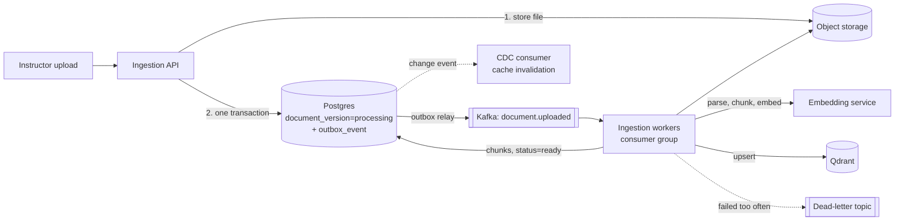

# LLD 04 — Ingestion & chunking

Depends on: LLD 01 (document, document_version, chunk, outbox_event), LLD 02 (roles: instructors upload).
Written after a step-by-step walkthrough (Steps 1–7). Feeds LLD 05 (Retriever) and LLD 06 (Semantic cache + CDC).

## 1. Why ingestion is asynchronous (Step 1)
Preparing a document (parse → chunk → embed → index) can take seconds to minutes. Doing it inside the upload request
would hang the instructor's browser, steal capacity from students, and leave nothing to retry on failure.

API replies in < 1 s with status `processing`. Status moves `uploaded → processing → ready | failed` (LLD 01).
Ingestion workers are a separate deployable from the chat service; uploads never block questions (ADR-1).

## 2. Parsing (Step 2)
| File type | Method | Main risk |
|---|---|---|
| Markdown / text | Read directly | — |
| DOCX, PPTX | Structure-aware library | Text boxes, speaker notes missed |
| PDF with text | PDF text extractor | Multi-column layout, tables scrambled |
| Scanned PDF | OCR | Slow, errors — **deferred past v1** (decision D1); scanned files fail with a clear reason |

Keep with the text: **page numbers, heading hierarchy, tables as tables** (needed for citations and chunking).
Sanity check: if extracted text is implausibly small for the page count → `failed` (v1) / route to OCR (later).

Failure handling: password-protected, corrupted, no-text and oversize files → `failed` with a **plain-language reason** the
instructor sees. Limits at upload: **50 MB, 300 pages** (D2).

Security (uploads are untrusted):
- Verify real file type (not just extension); reject mismatches.
- Malware scan before parsing.
- Parse in a restricted worker (parser libraries have had vulnerabilities).
- **Poisoned documents:** hidden instructions ("ignore your rules…") are a known threat (HLD §7). Two layers:
  (1) ingestion scans extracted text for injection phrases and flags the document for review;
  (2) at answer time retrieved text is passed to the model as *data to quote, never instructions*, and output guardrails still apply.

## 3. Chunking (Step 3)
| Choice | Decision |
|---|---|
| Size | ~400 tokens (range 300–500), tuned by measurement (D3) |
| Boundaries | Split by structure: headings → paragraphs → (only if needed) mid-paragraph. Never fixed character counts |
| Overlap | ~50 tokens between neighbours so boundary sentences survive whole |
| Tables | Kept whole; header row repeated if split |
| Code / formulas | Never split in the middle |
| Slides | One chunk per slide plus its notes |
| Embedding text | Prepend the heading path (e.g. "Database Connections > Timeouts") before embedding |

Each chunk stores: text, tenant_id, course_id, document_id, version_id, page, section heading, position index, token count,
content hash. Chunks are **rebuildable** from stored files/text: changing chunk size means re-chunk + re-embed, no re-upload.
Trade-off: too small loses context; too big blurs matching and costs tokens on every question.

## 4. Embeddings & vector store (Step 4)
- Chunks and questions **must use the same embedding model**; switching models means re-embedding everything.
- Embedding calls are **batched** (50–100 chunks/call), skip unchanged chunks via content hash, and retry with growing backoff on rate limits.
- Qdrant stores vector + payload (tenant_id, course_id, document_id, version_id, page, heading, chunk id).
  Payload indexes on tenant_id and course_id; **every search must include both filters** (LLD 01 §3).
- **Idempotent writes:** point id = chunk id, so a repeated write replaces rather than duplicates (needed because Kafka is at-least-once).
- **Versioned collections:** `chunks_v1`, `chunks_v2`… Switching models = build new collection in the background, flip an alias, delete the old one. No downtime.
- Keyword search (BM25) is also needed for exact terms (codes, acronyms); ingestion stores text in a keyword-searchable form. Hybrid ranking is designed in LLD 05.

## 5. Kafka (Step 5)
| Concept | Our usage |
|---|---|
| Topic | `document.uploaded` (plus retry and dead-letter topics) |
| Message | Ids only (tenant, course, document, version, storage key) — never file content |
| Key | `document_id` → same document always in the same partition → ordered; different documents parallel |
| Consumer group | Ingestion workers; add workers to scale |
| Delivery | **At least once**; commit offset only after the job finishes; all steps idempotent |

Failure policy (D4):
| Failure | Action |
|---|---|
| Temporary (rate limit, network) | Retry via **retry topics** with growing delay (e.g. 10 s, 1 min, 10 min), max 3 attempts; never sleep in a worker (it blocks the partition) |
| Permanent (encrypted, corrupt) | No retry; mark `failed` with reason |
| Repeated/unknown | Publish to **dead-letter topic**, alert; prevents a poison message blocking the partition |

Truth about progress lives in **Postgres** (`document_version` status, attempts, error reason), not Kafka.
**Outbox pattern:** API writes document row and `outbox_event` in one transaction; a relay publishes to Kafka. Prevents "row saved, message lost".
Monitor **consumer lag** — rising lag means add workers.
Honest note: Kafka is heavier than this traffic needs; chosen for learning and headroom. Design does not depend on Kafka-specific features, so a switch stays possible.

## 6. Updates, deletes, freshness (Step 6)
**Replace = new version + atomic swap**
1. New `document_version` goes through the normal pipeline while students keep using the old version.
2. When fully indexed and `ready`, switch `document.current_version_id` (single instant DB change).
3. Retrieval filters on current version only → old chunks stop being returned immediately.
4. Cleanup job removes old-version chunks after 7 days (D5).
5. Unchanged chunks (same content hash) are not re-embedded.
A failed new version leaves the old one current; students unaffected.

**Delete**
| Place | Action |
|---|---|
| Postgres | Soft delete (`deleted`); hard delete after **30 days** (D6); audit entry kept (append-only) |
| Qdrant | Delete chunks (retrieval already filters on status, so it stops at once) |
| Object storage | Delete original after grace period |
| Semantic cache | Delete entries built from this document |

**Cache freshness (CDC).** Every cached answer is tagged with the `document_id` + `version_id` of its sources. Upload/delete writes a
"document changed" event (outbox → Kafka); the CDC consumer deletes tagged cache entries. Second safety net: on cache read, if the entry's
version ≠ current version, treat as a miss. So a delayed event cannot serve stale answers.
Concurrent uploads of the same document: later version wins; same-key partitioning keeps order.
Unenrollment/course removal needs no re-indexing — access is checked via enrollment (LLD 01 §3a).

## 7. Records, alerts, tests (Step 7)
**Records:** status + plain-language failure reason + attempt count + progress ("embedding 40 of 120") on `document_version`;
a trace per document with timed steps; audit entries for upload/replace/delete. Never log document text — ids, sizes, counts only.
**Metrics/alerts:** upload→ready time, failure rate by reason, retries, dead-letter count, consumer lag; alert on growing lag,
any dead-letter arrival, or a sudden failure spike (usually a bad deploy or dependency).

| Test | Checks |
|---|---|
| Parser | Sample set (clean, two-column, table-heavy PDF, DOCX) → expected text and page numbers |
| Failure files | Encrypted, corrupt, empty, oversize, scanned → `failed` with right reason |
| Chunking | Respects headings/tables/code; overlap; size limit |
| Idempotency | Same message twice → exactly one copy of each chunk |
| Crash | Worker killed mid-document → another finishes, no duplicates |
| Retry / dead-letter | Temporary error retried and succeeds; permanent parked without blocking later messages |
| Atomic swap | During replace: only old, then only new; never mixed or empty |
| Freshness | After replace, previously cached answer no longer served |
| Delete | Disappears from search immediately, from all stores after cleanup |
| Isolation | Tenant A's chunks never returned for tenant B |
| Poisoned document | Injection text flagged; cannot alter answer behaviour |
Use fake parser/embedding services for speed; a smaller real-service set before releases.

## 8. Decisions (defaults — edit as you wish)
| # | Decision | Value |
|---|---|---|
| D1 | OCR in v1 | **No** (deferred); scanned PDFs fail with clear reason |
| D2 | Upload limits | 50 MB, 300 pages |
| D3 | Chunk size / overlap | ~400 / ~50 tokens, tune by measurement |
| D4 | Retry policy | 3 attempts, growing delays, then dead-letter |
| D5 | Old-version cleanup | After 7 days |
| D6 | Soft-delete grace | 30 days |
| D7 | Embedding model | Chosen at build time; collection name carries version |

## 9. Trade-offs
| Choice | Gain | Cost |
|---|---|---|
| Async ingestion | Fast upload, isolated from chat, retryable | Status is eventually consistent ("processing") |
| Atomic version swap | No mixed/missing content | Temporary double storage |
| Content-hash skip | Cheap small edits | Hash bookkeeping |
| Outbox | No lost messages | Extra table + relay |
| Idempotent writes + at-least-once | Simple, robust recovery | Every step must be repeat-safe |
| Soft delete | Undo + audit | Data lingers 30 days (check privacy policy per tenant) |
| Defer OCR | Simpler v1 | Scanned notes unsupported at first |
