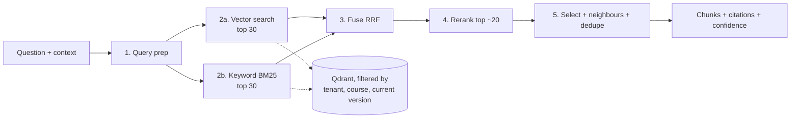

# LLD 05 — Retriever

Depends on: LLD 01 (tenant/course filters), LLD 03 (pipeline contract, 300 ms budget, shared embedding), LLD 04 (chunks, Qdrant payloads, versions).
Feeds: the Model stage (chunks + citations) and Output guardrails (groundedness check).

## 1. Purpose
Given a question and a course, return the few chunks most likely to contain the answer, with citations. The model answers **only** from these.
The retriever limits answer quality: the model cannot use what was not found, and can be misled by what should not have been returned.

| Failure | Effect | Metric |
|---|---|---|
| Misses the right chunk | Incomplete answer or false "not found" | **Recall** |
| Returns wrong/extra chunks | Distracted model, wrong citations, wasted tokens | **Precision** |

They trade off (50 chunks = high recall, low precision, high cost). The design is **start wide, then narrow**.
The retriever only finds and ranks; it never calls the model or decides how to answer. That keeps it independently testable.

## 2. Contract
- **Input:** question, tenant_id, course_id (from request context), question embedding (computed once, shared with cache), optional conversation history.
- **Output:** `chunks[]` (text, score, document_id, version_id, page, heading, chunk id), `confidence` (high/low/none), `none_found` flag.
- **Hard rule:** every search carries `tenant_id` + `course_id` + current-version filter. The retriever API rejects a call without them (LLD 01 §3).
- **Failure mapping (LLD 03):** error/timeout → required stage fails → "couldn't look that up right now" (never answer from nothing). Zero relevant chunks → `none_found`, a normal result, not an error.

## 3. Step 1 — Query preparation
Raw questions are often poor search queries, especially in a conversation.
| Case | Problem | Handling |
|---|---|---|
| Follow-up ("and what about the second one?") | Meaningless alone | **Rewrite** into a standalone question using recent history (small, cheap model call; skipped for first messages) |
| Typos, chatty text | Weak matches | Light normalization only (trim, lowercase for keyword side); embedding handles meaning |
| Abbreviations ("BCNF") | Embedding may be weak | Keep original term for the keyword search; optional per-course glossary expansion later |
| Very long question | Diluted embedding | Truncate to a token cap |
The rewrite adds latency and cost, so it runs only when the router/history indicates a follow-up. Embedding is computed on the rewritten text.
Trade-off: rewriting improves recall for follow-ups but can drift from what the student meant → log original and rewritten query.

## 4. Step 2 — Hybrid search
Two searches run **in parallel**, both filtered by tenant/course/current version:
| Search | Strength | Weakness |
|---|---|---|
| **Vector** (meaning) | Finds "drop a class" for "cancel my course" | Weak on exact terms, codes, acronyms, numbers |
| **Keyword BM25** | Exact terms ("BCNF", "CS-301", "Section 3.2") | Misses synonyms/paraphrases |
Each returns its top **30**. Combining beats either alone.
**Fusion:** Reciprocal Rank Fusion (RRF) — each chunk's score = sum over lists of 1/(k + rank). Uses ranks, not raw scores, so no need to calibrate two incomparable scales. Output: ~20 fused candidates.
Implementation note: Qdrant supports sparse+dense hybrid; BM25 side may use Qdrant sparse vectors or Postgres full-text. Decision D3 below.
Budget: ~50–100 ms (parallel).

## 5. Step 3 — Reranking
A **cross-encoder reranker** reads question + each candidate *together* and scores true relevance — much more accurate than the embedding similarity used in the first pass, but too slow for thousands of chunks, fine for ~20.
- Keep the top **5** by rerank score.
- Budget ~150 ms; must have a timeout. **Optional stage inside the retriever:** if the reranker times out or fails, fall back to the RRF order (top 5) and record `rerank: skipped` in the context. (Retriever overall stays required; this sub-step fails open because the fused order is still safe and usually acceptable.)
- Reranker choice: hosted rerank API or small self-hosted cross-encoder; decision D4. (HLD removed a self-hosted small *LLM*; a reranker is a different, much smaller component — default is a hosted API.)

## 6. Step 4 — Selection, context building, citations
After reranking:
1. **Score threshold:** drop chunks below a minimum rerank score. If none remain → `none_found` (bot says the notes don't cover it, or offers a human tutor).
2. **Confidence:** `high` (top score well above threshold), `low` (borderline), `none`. Router/escalation can use `low` (escalation trigger: LLD 10 §1).
3. **Neighbour expansion:** if a chunk was cut mid-explanation, optionally add the previous/next chunk (position index from LLD 04). Cap total tokens.
4. **De-duplicate:** drop near-identical chunks (overlap/duplicated slides).
5. **Token budget:** total context ≤ ~2,000 tokens (D2); keep the highest-ranked that fit.
6. **Citations:** each chunk carries document title, page, heading → shown to the student and checked by output guardrails.
Ordering for the model: best chunk first (and last, if long — models attend to the start and end of context best).

## 7. Isolation, freshness, security
- **Isolation:** tenant+course filters mandatory; leak test from LLD 01 applies directly to retrieval.
- **Freshness:** filter on `current_version_id` (LLD 04 atomic swap) so replaced/deleted documents stop appearing immediately, before cleanup.
- **Prompt injection via notes:** retrieved text is **data, not instructions**. The model prompt wraps chunks in clear delimiters and states this; chunks flagged at ingestion (LLD 04) are excluded or marked. Output guardrails remain the final check.
- **No cross-course** retrieval in v1 (LLD 01 D1).

## 8. Performance and budget (from LLD 03: ~300 ms)
| Sub-step | Budget |
|---|---|
| Query rewrite (follow-ups only) | +100 ms, run before the shared embedding |
| Vector + keyword (parallel) | 50–100 ms |
| Fusion + rerank | ~150 ms |
| Select/build context | < 10 ms |
The 300 ms budget (LLD 03) covers the non-follow-up path (vector+keyword ≈ 100 ms, rerank ≈ 150 ms, select < 10 ms). Follow-ups add the rewrite (~100 ms) before this stage; LLD 03 §6 accounts for it (TTFT ≈ 1.6 s for follow-ups).
Over budget → skip rerank first; then retrieve with vector-only; if still failing, required-stage failure.
Qdrant: payload indexes on tenant_id, course_id, version status; scale by shard/replica later.

## 9. Records and evaluation
**Per request (trace + message row):** rewritten query, candidate ids and scores, rerank on/off, final chunk ids, confidence, timings.
**Offline evaluation set** per course (or a shared benchmark): 50–200 questions with known right chunks/pages (written by instructors, or generated then reviewed).
| Metric | Meaning |
|---|---|
| Recall@5 | Right chunk is among the final 5 (target ≥ 90%) |
| MRR | How high the right chunk ranks |
| Precision@5 | Share of final chunks that are relevant |
| None-found accuracy | Out-of-scope questions correctly return none |
Run the evaluation on every change to chunk size, embedding model, k values or reranker; no change ships without comparing against the baseline.
**Online signals:** thumbs up/down, "not found" rate, escalation rate, groundedness failures from output guardrails.

## 10. Tests
| Test | Checks |
|---|---|
| Filter enforcement | Search without tenant/course filter is rejected |
| Isolation | Identical docs in two tenants → never cross-returned |
| Version | After replace/delete, old chunks never returned |
| Hybrid | Exact-term query ("BCNF") found via keyword; paraphrase found via vector |
| Fusion | Chunk strong in only one list still surfaces |
| Rerank fallback | Reranker down → results still returned in fused order, `rerank: skipped` logged |
| None-found | Out-of-scope question → `none_found`, not random chunks |
| Budget | Slow vector store → required-stage failure message, not hang |
| Follow-up rewrite | "and the second one?" resolves from history |
| Injection | Chunk with "ignore your instructions" does not alter model behaviour |
| Regression | Evaluation set metrics ≥ stored baseline |

## 11. Trade-offs
| Choice | Gain | Cost |
|---|---|---|
| Hybrid (vector + BM25) | Covers meaning and exact terms | Two indexes to maintain |
| Rerank top ~20 | Big precision gain | +~150 ms, extra dependency |
| Query rewrite for follow-ups | Conversation works | Extra call, risk of drift |
| Score threshold + none_found | Prevents guessing | Might say "not found" when notes partly cover it (tune threshold) |
| Neighbour expansion | Fixes cut-off explanations | More tokens |
| Router before retriever (LLD 03) | No retrieval cost for greetings | Router can't judge complexity from retrieved text |

## 12. Decisions (defaults — edit as you wish)
| # | Decision | Default |
|---|---|---|
| D1 | Candidates per search / after fusion / after rerank | 30 / 20 / 5 |
| D2 | Context token cap | ~2,000 tokens |
| D3 | Keyword search implementation | Qdrant sparse vectors (one store); Postgres FTS if limits hit |
| D4 | Reranker | Hosted rerank API; no self-hosted model in v1 |
| D5 | Score threshold | Set from the evaluation set (start conservative, tune) |
| D6 | Query rewrite | Follow-ups only, small hosted model |
| D7 | Neighbour expansion | On, capped by token budget |

## 13. Open items for later LLDs
- ~~Use `confidence=low` as an escalation signal~~ — done in LLD 10 §1 (repeated low/none results trigger a ticket).
- Whether the cache lookup uses the rewritten query (LLD 06; default: yes, so follow-ups cache sensibly).
- Per-course glossary / synonym expansion (post-v1).
