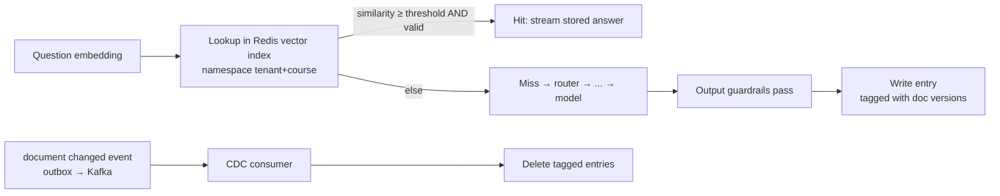

# LLD 06 — Semantic cache & change data capture (CDC)

Depends on: LLD 01 (tenant/course scoping, outbox), LLD 03 (cache is an optional stage, runs parallel to input guardrails, 50 ms budget), LLD 04 (document versions, change events), LLD 05 (rewritten query, shared embedding).

## 1. Purpose
Many questions repeat ("When is the Week 3 quiz?", "What is BCNF?"). A **semantic cache** returns a stored answer for a *similar-meaning* question, skipping retrieval and the model (the expensive stages). It is the biggest cost lever from Stage 0 (budget gap ≈ 15×).
Risk: a wrong or stale cached answer is served confidently. Correctness controls matter more than hit rate.

## 2. What is cached
| Field | Notes |
|---|---|
| key namespace | `t:{tenant_id}:c:{course_id}` — lookups cannot cross tenant or course by construction (LLD 01) |
| question embedding + normalized question text | For similarity search and debugging |
| answer text + citations | As streamed to the student |
| source tags | `[(document_id, version_id)]` of every chunk used |
| meta | created_at, ttl, model/route used, guardrail policy version, hit count, answer-quality flags |

**What is NOT cached:** answers marked personal or time-sensitive ("my grade", "today"), answers from the human tutor unless approved as FAQ, blocked/refused answers, answers with `confidence=low`, `none_found` results, and anything that failed output checks.

## 3. Lookup
1. Use the shared embedding of the (rewritten, standalone) question (LLD 05 §3) — follow-ups cache sensibly.
2. Vector search in the tenant+course namespace, top 1–3.
3. Accept only if **all** hold: similarity ≥ threshold; every source tag's `version_id` equals the document's **current** version (read-time safety net); not expired; guardrail policy version unchanged (else re-check, see §6).
4. Hit → stream stored answer through the same SSE path (`start/token/done`), mark `route=cache`. Cost ≈ 0, latency ≈ 50 ms.
Timeout 50 ms; any error/timeout → miss (optional stage, LLD 03).

## 4. Similarity threshold (the key tuning decision)
- Too low → "Is the quiz Friday?" matches "Is the exam Friday?" and returns the wrong answer. Too high → few hits.
- Start high (e.g. cosine ≥ 0.92, tune with data) because a wrong hit is worse than a miss.
- Tune using labeled pairs (same/different intent) from real traffic; track **false-hit rate** (target < 1%) alongside hit rate.
- Optional second check on borderline matches (0.88–0.92): cheap classifier/rule says "same intent?" (numbers, dates, negations must match).
- Questions with different numbers, names or negations ("not", "except") are bypassed from fuzzy matching.

## 5. Freshness: CDC + version check (two safety nets)
**Event-driven (CDC):** upload/replace/delete writes an outbox event (LLD 04) → Kafka topic `document.changed` → CDC consumer finds entries whose source tags include that `document_id` (Redis secondary index: `doc:{document_id}` → set of cache keys) and deletes them. Typically within seconds.
**Read-time check:** an entry tagged `v1` is ignored if the current version is `v2`, even if the event is delayed or lost.
**TTL as a backstop:** default 7 days; shorter (e.g. 1 day) for courses flagged as fast-changing; entries with deadline-like content get short TTL.
Also invalidate on: course settings change, grading policy/guardrail policy version bump, embedding model change (new namespace), manual "purge course cache" admin action.

## 6. Do cached answers re-run output guardrails? (open item from LLD 03)
Decision: **No, by default** — they passed output guardrails when stored, and re-running would cost latency. But the entry stores the **guardrail policy version**; if the current policy version differs, treat as a miss (or re-check). This keeps cached answers consistent with policy changes.

## 7. Write path
After a successful pipeline answer: output guardrails passed, confidence ≥ high, route used retrieval/model, not excluded by §2 → write entry (async, off the hot path), with TTL and source tags. Duplicate concurrent writes are idempotent (key = hash of namespace + normalized question).
**Cache stampede protection:** if 50 students ask the same new question at once, all miss simultaneously. Use a short-lived lock/"in-flight" marker per key: the first request computes; others wait briefly (≤ 500 ms) for the result, otherwise proceed normally.

## 8. Isolation and privacy
- Namespaced by tenant and course; leak test (identical question in two tenants never cross-hits).
- Never cache text containing PII detected by guardrails; store redacted text only.
- Cached answers are not user-specific; personalized answers are excluded (§2).
- Delete-user / delete-document flows purge related entries.

## 9. Failure modes
| Failure | Behaviour |
|---|---|
| Redis down/slow | Miss; pipeline continues (optional stage); alert |
| CDC consumer lagging | Read-time version check still prevents stale serves; lag alert |
| Bad threshold causing wrong hits | False-hit rate alarm; raise threshold or disable per tenant via feature flag |
| Stampede | In-flight marker (§7) |
| Cache poisoning (bad answer cached) | Only post-guardrail answers cached; thumbs-down on a cached answer evicts it and flags review |

## 10. Records and metrics
Per request: cache result (hit/miss/bypass reason), similarity score, entry id. Dashboards: **hit rate**, **false-hit rate** (sampled review + thumbs-down on cache hits), **$ saved** (avoided model tokens), lookup latency P95, CDC lag, invalidations/day, entries per tenant/course.
Expected hit rate for FAQ-style study questions: 30–40% (assumption from Stage 0; measure and revise).

## 11. Tests
| Test | Checks |
|---|---|
| Hit/miss | Paraphrase hits; different-intent question misses |
| Numbers/negation | "Is it Friday?" vs "Is it not Friday?" never cross-hit |
| Isolation | Same question in two tenants/courses never cross-hits |
| Freshness | Replace document → cached answer gone (event path) and ignored (version-check path with event suppressed) |
| Policy version | Policy bump → entries not served unguarded |
| Failure | Redis down → answer still arrives |
| Stampede | 50 concurrent identical questions → 1 model call |
| Exclusions | Low-confidence, personal, blocked answers never cached |
| Streaming | Cached answer streams with same events as live |

## 12. Trade-offs
| Choice | Gain | Cost |
|---|---|---|
| High similarity threshold | Few wrong answers | Lower hit rate |
| Per-course namespace | Strong isolation, simple | No sharing across courses (lower hits) |
| CDC + read-time version check | Robust freshness | Source-tag index to maintain |
| Skip output re-check on hit | Speed | Relies on policy-version stamp |
| Cache only high-confidence answers | Quality | Fewer entries |

## 13. Decisions (defaults — edit as you wish)
| # | Decision | Default |
|---|---|---|
| D1 | Store | Redis with vector index (RediSearch) — the **cache Redis** deployment, separate from the control Redis used for rate limits/idempotency/sessions (HLD ADR-8) |
| D2 | Similarity threshold | 0.92 cosine, tuned from labeled data |
| D3 | TTL | 7 days (1 day for fast-changing courses) |
| D4 | Borderline second check | On for 0.88–0.92 |
| D5 | Re-run output guardrails on hit | No; policy-version stamp instead |
| D6 | Stampede wait | ≤ 500 ms |
