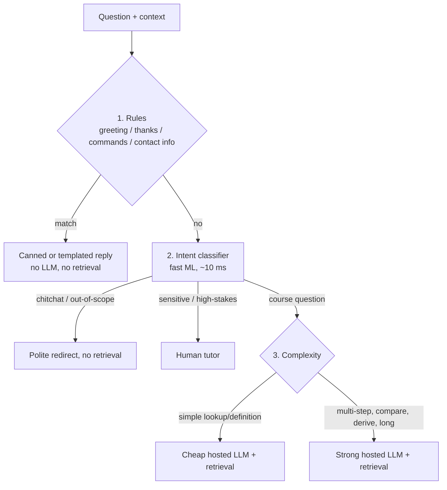

# LLD 07 — Router (minimum sufficient intelligence)

Depends on: LLD 03 (router is an optional stage, 50 ms budget, runs before retriever), LLD 05 (retriever, confidence), LLD 06 (cache hits skip routing).
HLD decision: self-hosted small model removed; both LLM tiers are **hosted** models behind the Model Gateway (LLD 09).

## 1. Purpose
Choose the cheapest handler that can answer correctly, and whether retrieval is needed. Principle from the video: **minimum sufficient intelligence** — don't use a frontier model for "hi".
Stage 0 showed a naive all-strong-model design is ~15× over budget; routing + cache closes most of that gap.

## 2. Routes (the output)
| Route | Retrieval | Handler | Typical cost |
|---|---|---|---|
| `rule` | No | Template/canned answer | ~0 |
| `redirect` | No | Canned "I can only help with your course notes" | ~0 |
| `cheap_llm` | Yes | Small hosted model | low |
| `strong_llm` | Yes | Frontier hosted model | high |
| `human` | No | Escalation ticket (LLD 10) | human time |
Router returns `{route, needs_retrieval, reason, confidence}` into the request context (LLD 03 contract).

## 3. Tier 1 — Deterministic rules (0 ms, 0 cost)
Greetings/thanks/goodbye, "help", "who are you", empty or one-word input, known commands, regex-detectable asks (e.g. "office hours" → lookup template). Rules are explicit, tested, and easy to audit. Keep the list small; anything unsure falls through.

## 4. Tier 2 — Intent classifier (~10 ms, near 0 cost)
A small classical ML model (e.g. logistic regression / gradient boosting over embeddings or TF-IDF) — **no LLM call**. Classes:
`course_question`, `chitchat`, `out_of_scope`, `sensitive_or_high_stakes` (grade disputes, cancellation, personal circumstances, mental health, complaints), `unclear`.
- Trained on labeled real/synthetic questions; retrained periodically; versioned.
- Uses the **existing question embedding** (LLD 03) so it adds almost no latency.
- `sensitive_or_high_stakes` and `confidence < threshold` on risky classes → **bias toward human**; recall matters more than precision here.
- `unclear` → ask a clarifying question (no retrieval spend) or default to `cheap_llm`.

## 5. Tier 3 — Complexity (cheap vs strong)
Signals (computed without an LLM): question length, number of sub-questions ("and", "compare", "step by step"), presence of math/code, keywords ("derive", "prove", "why"), conversation depth, classifier's complexity head.
Default **cheap**; upgrade to **strong** when complexity score ≥ threshold.
**Escalation of model tier on failure (cascade):** if the cheap model's answer fails output groundedness check or signals low confidence, retry **once** with the strong model. This guards against under-routing at the cost of occasional double calls. Cap: 1 retry per request.
Known limitation (accepted in LLD 03): the router decides before retrieval, so it can't use retrieved text to judge difficulty. Revisit if the cascade rate is high.

## 6. Failure behavior (optional stage, LLD 03)
Router error/timeout (50 ms) → default route: `cheap_llm` + retrieval (safe, cheap). Classifier unavailable → rules only, else default. Never block the answer. Sensitive detection failing open is a risk, so rules for the highest-risk keywords (self-harm, harassment, legal threats) are always checked first in Tier 1 and route to `human`/safety response.

## 7. Guardrails interaction
Input guardrails run before (and parallel with cache). Router never sees blocked content. Safety-related Tier 1 matches route to the safe-response path, bypassing the LLM.

## 8. Cost accounting
Estimated mix (assumption to validate): ~15% rules/redirect, ~35% cache (before router), ~35% cheap, ~10% strong, ~5% human.
Blended cost target: ≤ $50/month at 4,800 req/day → average ≈ $0.00035/request; revisit after measurement. Each response records route, model, tokens, cost (LLD 01 `message` row).

## 9. Evaluation
- **Router accuracy** on a labeled set: per-class precision/recall; sensitive-class **recall ≥ 98%**.
- **Under-routing rate:** cases where cheap was chosen but cascade/groundedness check triggered strong (target < 10%).
- **Over-routing rate:** strong chosen where cheap matched quality (sampled A/B review) — wasted spend.
- **Quality by route:** groundedness and thumbs-up by route; cost per route.
Shadow mode for new router versions: run alongside production, compare decisions, no user impact.

## 10. Tests
| Test | Checks |
|---|---|
| Rules | "hi", "thanks" → `rule`, no retrieval, no LLM call |
| Classifier | Sensitive samples → `human`; out-of-scope → `redirect` |
| Complexity | Simple definition → cheap; multi-step derivation → strong |
| Cascade | Cheap answer fails groundedness → one strong retry, then stop |
| Failure | Router timeout → default route; answer still arrives |
| Latency | Router P95 ≤ 50 ms |
| Safety | High-risk keywords always take the safe path even if classifier down |

## 11. Trade-offs
| Choice | Gain | Cost |
|---|---|---|
| Rules → ML → LLM ladder | Most traffic is nearly free | Three components to maintain |
| ML classifier instead of LLM router | Fast, cheap, deterministic | Needs labeled data and retraining |
| Default to cheap + cascade | Low cost, safety net | Occasional double calls, added latency on cascade |
| Bias toward human on sensitive | Safe | More human load; tune threshold |
| Decide before retrieval | Skips retrieval cost for non-notes | Can't judge difficulty from retrieved text |

## 12. Decisions (defaults — edit as you wish)
| # | Decision | Default |
|---|---|---|
| D1 | Routes | rule, redirect, cheap_llm, strong_llm, human |
| D2 | Classifier | Small classical model over existing embedding; versioned |
| D3 | Default on router failure | cheap_llm + retrieval |
| D4 | Cascade | Cheap → strong once on failed groundedness/low confidence |
| D5 | Sensitive-class recall target | ≥ 98% |
| D6 | New router versions | Shadow mode first |
