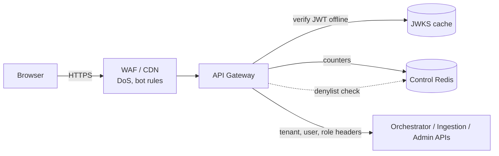
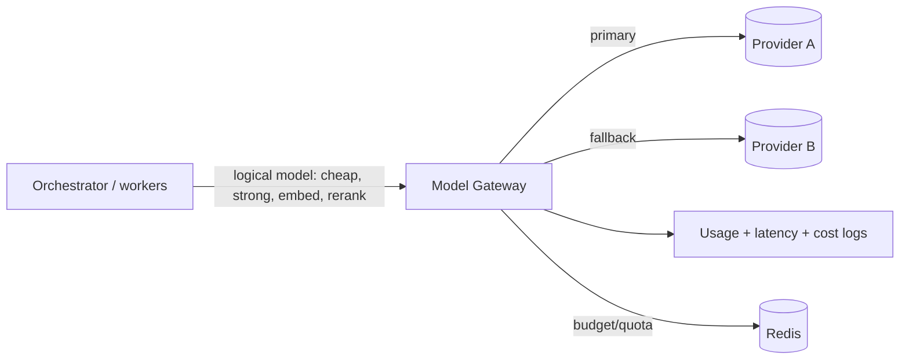

# LLD 09 — API Gateway & Model Gateway

Two gateways, two jobs. **API Gateway** protects our system from clients. **Model Gateway** protects our system from model providers (and our wallet from the models).
Depends on: LLD 02 (JWT, roles), LLD 03 (concurrency/backpressure, SSE), LLD 01 (tenant budgets, usage ledger).

## Part A — API Gateway (edge)

### A1. Responsibilities
TLS termination · WAF/DoS protection · JWT verification (Keycloak JWKS cached) · coarse route authorization · rate limits · token/cost budgets · request size limits · request-id/trace-id injection · CORS · SSE-friendly timeouts. It does **not** run business logic.

### A2. Request checks in order (cheapest first)
1. WAF: IP reputation, request size, malformed requests.
2. TLS + HTTP validation; reject oversized bodies (chat: small; uploads: via pre-signed URL to object storage, not through the gateway, to avoid proxying 50 MB files).
3. JWT: signature, `exp`, `iss`, `aud`; 60 s clock skew; check Redis **denylist** for disabled users.
4. Route rules: `/admin/*` needs `tenant_admin`, `/ingest/*` needs `instructor`, `/chat/*` needs `student|instructor`, `/tutor/*` needs `tutor`.
5. **Rate limits** (below).
6. **Budget check** (below).
7. Forward with **trusted headers** (`X-Tenant-Id`, `X-User-Id`, `X-Role`, `X-Request-Id`, `X-Trace-Id`); the gateway strips any client-supplied versions of these. Internal services accept them only from the gateway (network policy / mTLS).

### A3. Rate limiting
Algorithm: **token bucket** (allows short bursts, enforces average) with counters in the **control Redis** (atomic Lua script; HLD ADR-8), keyed by dimension:
| Dimension | Example limit | Why |
|---|---|---|
| Per IP (before auth) | 60 req/min | Anonymous abuse, login flooding |
| Per user | 20 chat req/min, burst 5 | One student can't spam |
| Per tenant | e.g. 600 req/min (by plan) | Fair share; noisy-neighbor control |
| Per route | Upload: 10/min/user | Expensive endpoints stricter |
Response: `429` with `Retry-After`; frontend shows "slow down a moment". Limits are config per plan, not code.
**Distributed correctness:** gateway replicas share Redis; if Redis is down → **fail open for per-user limits with a local in-memory fallback limit** (so we don't cause an outage) but **fail closed for budget exhaustion checks on cached state** (see A4). Alert either way.
Concurrency limits (active streams per user/tenant) live in the orchestrator (LLD 03 §7); the gateway handles request-rate limits.

### A4. Token / cost budgets
- Each tenant has `monthly_token_budget` (LLD 01) and each user a daily token quota (e.g. 50k tokens).
- Hot-path check is against a **Redis counter** updated by the orchestrator after each answer (async ledger in Postgres is the truth; Redis is rebuildable).
- States: **ok → warning (80%, notify tenant admin) → soft limit (route only to cheap model, shorter answers) → hard limit (blocked with clear message / "contact your admin")**.
- Per-request cap: max output tokens enforced via Model Gateway.
- Counters are approximate near the limit (concurrent requests can slightly overshoot) — accepted.

### A5. Streaming (SSE) specifics
Long-lived connections need: idle timeout ≥ 60 s with periodic keep-alive comments, no response buffering on proxies (`X-Accel-Buffering: no`), HTTP/2, and graceful deploy (drain streams before shutting down instances). Detect client disconnect and propagate cancellation to the orchestrator (LLD 03 §7).

### A6. Security extras
Strict CORS (our SPA origin only), security headers (HSTS, CSP), request/response size limits, JSON schema validation at the edge for the chat endpoint, no stack traces in errors, audit log of auth failures, WAF managed rules, bot protection on login pages (Keycloak side).

## Part B — Model Gateway (LiteLLM-style proxy)

### B1. Why a gateway for models
All LLM and embedding/rerank calls go through one component (ADR-4): **failover**, **quota enforcement**, **central secrets**, **uniform logging/cost accounting**, and the freedom to swap providers without touching pipeline code. Application code asks for a **logical model name**, not a vendor.

### B2. Logical models and routing table
| Logical name | Primary | Fallback | Used by |
|---|---|---|---|
| `chat-cheap` | Provider A small model | Provider B small model | Router cheap route, query rewrite |
| `chat-strong` | Provider A frontier model | Provider B frontier model | Router strong route, cascade |
| `embed` | Embedding model v1 | (none; same model required, LLD 04) | Cache, retrieval, ingestion |
| `rerank` | Hosted reranker | skip (retriever falls back) | Retriever |
| `judge` | Small model | — | Guardrails (borderline) |
Mapping lives in config, versioned; changing a model is a config change + evaluation run, not a code change.
Note: embeddings can't fail over to a *different* model without re-embedding (LLD 04); embedding failover = retry/other region of the same model.

### B3. Reliability behavior
| Mechanism | Rule |
|---|---|
| **Timeouts** | Connect 1 s; time-to-first-token 2 s (cheap) / 3 s (strong); total per route |
| **Retries** | 1 retry on transient errors (429/5xx/timeout) with jitter; never retry non-idempotent partial streams after tokens were sent |
| **Failover** | On repeated errors, route to fallback provider |
| **Circuit breaker** | After N failures in a window, stop calling the primary for a cool-off period (e.g. 60 s), then probe (half-open) |
| **Health checks** | Passive (error rate, latency) + occasional active probe |
| **Streaming failover** | Only before the first token is sent; after tokens are sent, fail the stream with an error message (can't splice providers mid-answer) |
| **Degraded mode** | All providers down → cache-only + "service busy, try again / ask a tutor" |
Quality caveat: fallback model may answer differently → fallback usage is logged and evaluated; prompts are kept provider-neutral.

### B4. Quotas, budgets, rate limits (provider side)
- Provider rate limits (RPM/TPM) are tracked centrally; the gateway **queues/throttles** to stay under them and returns a clean 429/`busy` upstream if exceeded.
- Per-tenant and per-user token accounting recorded per call (feeds A4 and the usage ledger).
- Max input/output tokens per logical model enforced; oversized contexts trimmed by the retriever (LLD 05 token cap).
- Bulk/async work (ingestion embeddings) goes through a **separate lower-priority lane** so it can't starve live chat; backed by Kafka retry topics (LLD 04).

### B5. Secrets and security
Provider API keys exist **only** in the model gateway (secret manager, rotated); services authenticate to the gateway with service identity. No keys in app code, logs or the browser. Outbound allow-list to provider domains. Prompts/outputs are not logged in plain text by default (privacy; redacted/hashed with ids and token counts); opt-in evaluation table exceptions per LLD 01. Provider data-retention/zero-retention settings chosen per tenant contract.

### B6. Caching at the model layer (optional)
Provider **prompt caching** (stable system prompt prefix) reduces cost/latency; keep the system prompt and instructions first and stable, variable parts (chunks, question) last. Separate from our semantic cache (LLD 06).

### B7. Observability
Per call: logical model, actual provider/model, latency (TTFT, total), tokens in/out, cost, retries, failover flag, error type, tenant/user ids, trace id. Dashboards: provider error rate, failover count, P95 TTFT per model, spend per tenant/day, budget burn. Alerts: failover active > N min, spend anomaly, circuit open.

## Tests
| Test | Checks |
|---|---|
| JWT | Expired/forged/wrong-audience rejected; clock skew tolerated |
| Header trust | Client-sent `X-Tenant-Id` stripped/ignored |
| Route authorization | Student cannot call `/admin`, instructor-only routes |
| Rate limit | Burst allowed up to bucket, then 429 with Retry-After; limits per user/tenant/IP independent |
| Redis down | Gateway still serves (local fallback), alert fires |
| Budget | Soft limit → cheap-only; hard limit → clear block; 80% warning |
| SSE | Long stream survives idle timeout; disconnect cancels upstream call |
| Failover | Primary 5xx → fallback used before first token; none after tokens sent |
| Circuit breaker | Opens after N failures, probes, recovers |
| Quota | Provider 429 handled with queue/backoff, not cascade failures |
| Secrets | No keys in logs or responses |
| Priority lanes | Ingestion flood does not slow live chat |

## Trade-offs
| Choice | Gain | Cost |
|---|---|---|
| Gateway verifies JWT offline | Fast, no IdP in hot path | Revocation delay → short TTL + denylist |
| Token bucket in Redis | Burst-friendly, shared across replicas | Redis dependency (local fallback) |
| Approximate budget counters | Fast hot path | Slight overshoot near the limit |
| Single model gateway | Failover, central control, easy swap | One more critical component (run HA) |
| Provider failover | Resilience | Different answer styles; fallback must be evaluated |
| No mid-stream failover | Simple, honest | Rare visible error on provider crash mid-answer |

## Decisions (defaults — edit as you wish)
| # | Decision | Default |
|---|---|---|
| D1 | Edge | Managed WAF/CDN (Cloudflare-style) + NGINX/Envoy gateway |
| D2 | Limits | IP 60/min; user 20 chat/min (burst 5); tenant by plan; uploads 10/min |
| D3 | Budgets | Tenant monthly + user daily; warn 80%, soft limit cheap-only, hard block |
| D4 | Model gateway | LiteLLM proxy, 2 providers (A primary, B fallback) |
| D5 | Uploads | Pre-signed URL direct to object storage, not through the gateway |
| D6 | Mid-stream failover | Not supported |
| D7 | Prompt logging | Redacted/hashed by default; raw only in opt-in eval table |
