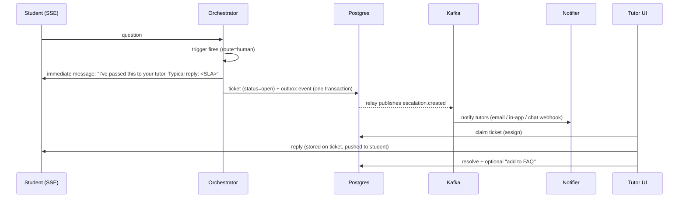

# LLD 10 — Escalation (human-in-the-loop)

Depends on: LLD 01 (`escalation_ticket`, D4 ticket-only access to chats), LLD 02 (tutor role, audit), LLD 05 (confidence), LLD 07 (`human` route), LLD 08 (safety routes), LLD 04/09 (Kafka).
Purpose: some questions are too sensitive, uncertain or important for a bot. The system hands them to a human tutor — safely, quickly, and with context.

## 1. When to escalate (triggers)
| Trigger | Source | Example |
|---|---|---|
| Sensitive / high-stakes topic | Router class (LLD 07) | Grade dispute, extension/accommodation, complaint, personal hardship |
| Safety concern | Input guardrails (LLD 08) | Self-harm, harassment — **also shows immediate safety resources to the student** |
| Low retrieval confidence / none found, repeated | Retriever (LLD 05) | Student asks 2+ times, notes don't cover it |
| Failed answer checks | Output guardrails (LLD 08) after cascade | Groundedness fails with strong model too |
| Explicit user request | UI button "Ask a tutor" | Student chooses to |
| Frustration signals | Classifier: repeated rephrasing, thumbs-down, negative tone | Optional, v1.1 |
| System degraded | Model gateway all-providers-down (LLD 09) | Offer tutor instead of error |

## 2. Flow

The student is **never left with silence**: they get an immediate, honest acknowledgement with the expected response time and what happens next.

## 3. Ticket lifecycle
`open → assigned → in_progress → resolved | closed_no_response | reopened`
Fields (extends LLD 01): ticket id, tenant_id, course_id, student id, message_id, trigger reason, priority, assigned_tutor_id, created/claimed/resolved timestamps, resolution text, outcome (answered / referred elsewhere / out of scope), "approved as FAQ" flag, SLA deadline.
- **Priority:** `urgent` (safety), `high` (grade/deadline-related), `normal`. Urgent bypasses queue ordering and alerts on-call.
- **Assignment:** tutors for the course (instructor-managed roster); claim model (first to claim) in v1; round-robin/load-based later. Unclaimed past threshold → re-notify → escalate to instructor.
- **SLA:** targets per priority (e.g. urgent 1 h business hours, normal 1 business day) set by tenant; shown to student; breach alerts to admin.

## 4. What the tutor sees (privacy, D4 from LLD 01)
Only the **assigned tutor** sees the ticket and the **attached conversation** (the escalated message and a bounded window of preceding messages, not the student's whole history). Includes: the question, the bot's attempted answer (if any), retrieved sources, why it escalated. Every read is **audit-logged** (LLD 02). Raw content comes from `message_raw` only if the tenant opted in; otherwise redacted text plus the student's resubmitted detail on the ticket (tutor can ask the student). Tutors cannot browse other students' chats.
Sensitive/safety tickets: restricted to a smaller group (e.g. designated tutors/counsellors); content warning banner.

## 5. Student experience
- Chat shows a ticket card: status, expected time, option to add details or cancel.
- Tutor's reply appears in the same conversation (and by email if the student left), clearly labeled "Tutor".
- Student can mark "resolved / still need help" (reopens).
- Safety triggers: show crisis/support resources immediately (static, tenant-configured), independent of tutor availability.

## 6. Feedback loop into the system
- Tutor marks "good FAQ" → answer becomes an **approved FAQ entry**: stored in Postgres, indexed, and written to the semantic cache (LLD 06 §2 exception) with the tutor's identity and review date; subject to CDC freshness like any answer.
- "Retrieval gap" flag by tutor → report to instructor: notes don't cover X.
- Escalation reasons feed router training data and guardrail tuning (LLD 07/08) — human labels are the most valuable training signal.
- Metrics review: top escalation topics weekly per course.

## 7. Failure modes
| Failure | Behaviour |
|---|---|
| Kafka/notifier down | Ticket is already in Postgres (outbox); relay retries; tutors still see it in the Tutor UI queue; no lost tickets |
| No tutor configured for course | Route to instructor/tenant admin; warn admin at config time |
| Nobody responds within SLA | Re-notify, then escalate to instructor, then admin; student told honestly of delay |
| Escalation storm (outage) | Rate-limit tickets per user; deduplicate identical open tickets; show "already with your tutor" |
| Student abuses escalation | Per-user ticket rate limit |
| Wrong escalation (false positive) | Tutor marks "bot could have answered" → training signal |
| Safety ticket missed | Urgent alert to on-call + backup recipients; tested by drills |

## 8. Records and metrics
Ticket and audit rows; trace link from message → ticket. Metrics: escalation rate (% of questions; expect ~5%), by trigger, time to first response, time to resolve, SLA breach %, reopen rate, "bot could have answered" rate, FAQ promotions. Alerts: SLA breach, unclaimed urgent ticket, spike in escalations.

## 9. Tests
| Test | Checks |
|---|---|
| Triggers | Each trigger creates exactly one ticket, with correct priority |
| Immediate ack | Student gets acknowledgement even when Kafka/notifier is down |
| Access control | Only assigned tutor reads the conversation; other tutor/instructor denied; read audited |
| Window | Tutor sees only the bounded conversation window |
| Safety | Safety trigger shows resources + urgent ticket |
| SLA | Unclaimed ticket re-notifies and escalates on schedule |
| Dedup | Repeated identical escalation attaches to existing ticket |
| FAQ promotion | Tutor-approved answer served from cache, then invalidated on document change |
| Isolation | Tenant A tutors never see tenant B tickets |

## 10. Trade-offs
| Choice | Gain | Cost |
|---|---|---|
| Bias toward escalation on sensitive topics | Safety, trust | Human load; tune thresholds |
| Ticket-only privacy (D4) | Strong privacy | Tutors may need to ask the student for context |
| Outbox for ticket events | No lost tickets | Extra relay |
| Claim model | Simple | Possible uneven load; later round-robin |
| Tutor answers feed the cache | Cost saving, quality | Needs review/expiry to avoid stale human answers |

## 11. Decisions (defaults — edit as you wish)
| # | Decision | Default |
|---|---|---|
| D1 | Assignment | Claim model, per-course tutor roster |
| D2 | SLA | Urgent 1 h; high 4 h; normal 1 business day (tenant-configurable) |
| D3 | Notification channels | In-app + email; chat webhook (Slack/Teams) later |
| D4 | Conversation window for tutors | Escalated message + previous 10 messages |
| D5 | Safety handling | Immediate static resources + urgent ticket + restricted tutor group |
| D6 | Frustration detection | Deferred to v1.1 |
