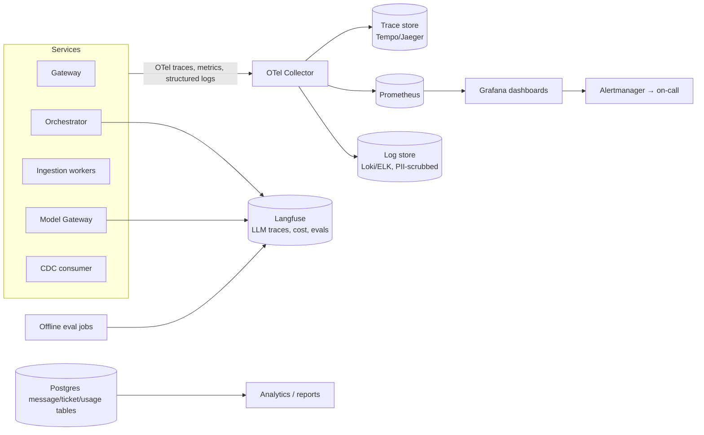

# LLD 11 — Observability (telemetry, evaluation, alerting)

Depends on: all earlier LLDs (each defined its records and metrics). This doc unifies them: **how do we know the system is working, cheap, safe and good?**
Tools (from HLD): OpenTelemetry for traces/metrics/logs, Prometheus + Grafana for metrics/alerts, Langfuse (or equivalent) for LLM-specific traces, evaluation and prompt tracking.

## 1. Four questions observability must answer
| Question | Signals |
|---|---|
| Is it **up and fast**? | Availability, error rate, TTFT/total latency P50/P95/P99, queue lag |
| Is it **affordable**? | Tokens and $ per request/tenant/route, cache savings, budget burn |
| Is it **safe**? | Guardrail blocks, PII hits, injection attempts, cross-tenant check failures |
| Is it **good**? | Groundedness, retrieval recall, thumbs up/down, escalation rate, "not found" rate |
A fast, cheap, wrong answer is a failure, so quality is a first-class signal, not an afterthought.

## 2. Architecture

## 3. Tracing
One **trace id** from gateway to model (set at the gateway, propagated via headers and Kafka message headers).
Spans: `gateway`, `context_load`, `input_guardrails`, `cache_lookup`, `router`, `retrieve` (children: `rewrite`, `vector`, `bm25`, `rerank`), `model_call` (TTFT, tokens), `output_guardrails` (per chunk), `stream`, plus async `ingest.*` spans and `cdc.invalidate`.
Span attributes: tenant_id, course_id, route, model, cache result, rule fired, policy version, token counts, cost, outcome (`ok|skipped|failed`). **No raw text, no PII** in attributes.
Sampling: keep 100% of errors, blocked, escalated and slow (> P95) traces; sample ~10% of normal traces; Langfuse keeps all LLM calls' metadata (not content) — content only for the opt-in tenants (LLD 01).

## 4. Metrics (SLIs) and targets (SLOs)
| Area | SLI | SLO / target |
|---|---|---|
| Availability | % successful chat requests (excluding user errors) | ≥ 99.5% (Stage 0) |
| Latency | TTFT P95 | < 1.5 s |
| Latency | Total answer time P95 | < 6 s |
| Cost | Avg $/request; tenant spend vs budget | ≤ target ($50/month overall at planned volume; revisit) |
| Cache | Hit rate; false-hit rate | 30–40% hit; < 1% false |
| Retrieval | Recall@5 (offline) ; "not found" rate (online) | ≥ 90% ; track trend |
| Quality | Groundedness (sampled human + automated) | ≥ 90% |
| Safety | PII leak events; blocked attacks; cross-tenant isolation canary | 0 leaks; canary always passing |
| Queue | Ingestion consumer lag; dead-letter count; upload→ready time | lag < N min; DLQ = 0 |
| Escalation | Rate; time to first tutor response; SLA breaches | ~5%; per SLA |
| Dependencies | Provider error rate, failover count, circuit-open time | alerts below |
**Error budget:** 99.5% allows ~3.6 h/month downtime; if burned fast, freeze feature releases and fix reliability first.

## 5. Dashboards
1. **Service health** (golden signals per component, per-stage latency waterfall).
2. **Cost** (by tenant, route, model; cache $ saved; budget burn; forecast).
3. **Quality** (groundedness, thumbs, escalation, none-found by course; retrieval eval trend).
4. **Safety** (blocks by rule, injection attempts, PII hits, offenders).
5. **Ingestion** (queue lag, failures by reason, time to ready, DLQ).
6. **Tenant view** (per university: usage, top questions topics, unanswered questions, escalation load) — a product feature for tenant admins/instructors, aggregated and privacy-safe.

## 6. Alerting
Principles: alert on **symptoms users feel** (SLO burn), not every internal blip; every alert has an owner, a runbook link, and a severity.
| Alert | Severity | Condition (example) |
|---|---|---|
| Chat availability burn | Page | Error budget burn rate high over 5 min and 1 h |
| TTFT P95 breach | Page/ticket | > 1.5 s for 10 min |
| Provider outage / failover active | Ticket → page if > 15 min | Circuit open |
| Cross-tenant canary failure | **Page immediately** | Any |
| PII leak detected in output | **Page** | Any |
| Spend anomaly | Ticket | Daily spend > 2× rolling average; tenant at 80% budget → notify tenant admin |
| Ingestion lag / DLQ | Ticket | Lag growing > 15 min; any DLQ arrival |
| Cache false-hit spike | Ticket | Thumbs-down on hits > threshold |
| Guardrail block spike | Ticket | Possible attack or false-positive rule |
| Urgent ticket unclaimed / SLA breach | Page (urgent) / ticket | LLD 10 |
| Redis/Qdrant/Kafka health | Page | Component down |
Synthetic canary: a scheduled **end-to-end probe** (test tenant) asks known questions every minute — checks availability, latency, correct citation, **and that tenant B's canary data never appears for tenant A**.

## 7. LLM quality evaluation
- **Offline eval sets** (per LLD 05, 08): retrieval recall/precision, groundedness, red-team safety, router accuracy. Run in CI on every change to prompts, models, chunking, thresholds, reranker; compare to baseline; block regressions.
- **Online sampling:** sample N answers/day per tenant (opt-in raw text) for automatic LLM-judge scoring (groundedness, helpfulness, citation accuracy) and a small human-review queue for calibration. Judge itself calibrated against human labels.
- **User feedback:** thumbs up/down + reason; negative on cached answer evicts it (LLD 06).
- **Prompt/version tracking:** every answer records prompt version, model, policy version, router version, embedding/collection version, so regressions can be traced to a change.
- **A/B and shadow:** new model/router/threshold run in shadow or on a small tenant slice with metrics compared before rollout.

## 8. Logging and privacy
Structured JSON logs, correlation by trace id. **PII-scrubbed at source** (redacted question text only; never raw text, tokens, secrets). Log levels: INFO for state changes, WARN for fail-open stages, ERROR for fail-closed. Retention: operational logs 30 days, traces 14 days, metrics 13 months aggregated, audit log 1 year (LLD 01). Access to logs/Langfuse is role-based and audited; tenant data never leaves its tenant scope in tenant-facing dashboards. Opt-in raw evaluation content follows LLD 01 (30-day TTL, restricted role).

## 9. Operations
- **Runbooks** for each page alert (provider failover, Redis down, queue lag, cache false-hit disable via feature flag, guardrail rule kill-switch with approval).
- **Incident process:** severity levels, status page, post-incident review with action items.
- **Feature flags** for: cache per tenant, rerank on/off, model tier mapping, router versions — safe, instant levers during incidents.
- **Capacity review** monthly using real request, token, and ingestion numbers vs Stage 0 assumptions; update the capacity math.
- **Load tests** before launch and after major changes: peak (exam eve ~3 QPS and 10× bursts), ingestion floods, provider failure drills.

## 10. Chaos / failure drills (verify the fail-open/closed table of LLD 03)
Kill Redis → answers continue (cache miss, limits fallback). Kill the reranker → fused order used. Kill the primary model provider → failover. Kill output guardrails → no unchecked output sent. Kafka down → tickets still saved, notifications resume later. Run quarterly (game days).

## 11. Tests
| Test | Checks |
|---|---|
| Trace completeness | A request produces spans for every stage with the same trace id, including across Kafka |
| No PII | Logs/spans for PII-laden request contain no raw PII |
| Metric correctness | Known request mix → expected cost/latency/cache numbers |
| Alert firing | Injected failure (slow retriever, provider 5xx, DLQ message) fires the expected alert and no more |
| Canary | Cross-tenant leak simulated → page fires |
| Dashboard data | Tenant view shows only that tenant's data |
| Eval pipeline | Regression in a prompt lowers eval score and blocks CI |
| Retention | Raw eval content expires on schedule |

## 12. Trade-offs
| Choice | Gain | Cost |
|---|---|---|
| OTel + Prometheus + Langfuse | Open standards, LLM-specific insight | Several systems to run (managed options exist) |
| Sampled tracing | Cost control | Rare issues in unsampled traffic (mitigate: keep all errors/slow) |
| Metadata only by default | Privacy | Harder debugging; opt-in raw content for evaluation |
| LLM-judge for online quality | Scales evaluation | Judge bias/cost; calibrate with human labels |
| Strict SLO-based alerts | Less alert fatigue | Slow-burn issues need dashboards/reviews |

## 13. Decisions (defaults — edit as you wish)
| # | Decision | Default |
|---|---|---|
| D1 | Instrumentation | OpenTelemetry everywhere; trace id through Kafka headers |
| D2 | Stack | Prometheus + Grafana + Alertmanager; Tempo/Loki or managed equivalents; Langfuse for LLM traces/evals |
| D3 | Trace sampling | 100% errors/blocked/escalated/slow; ~10% others |
| D4 | SLOs | 99.5% availability; TTFT P95 < 1.5 s; total P95 < 6 s; groundedness ≥ 90% |
| D5 | Retention | Logs 30 d; traces 14 d; metrics 13 mo; audit 1 yr |
| D6 | Canary | Per-minute end-to-end probe incl. cross-tenant check |
| D7 | Game days | Quarterly failure drills |
