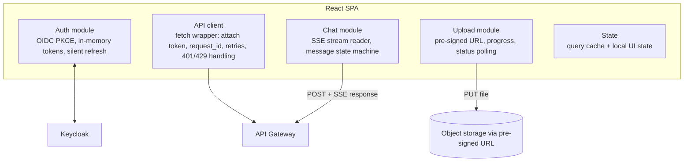

# LLD 12 — Frontend (React SPA) & SSE streaming client

Depends on: LLD 02 (OIDC PKCE login, tokens), LLD 03 (SSE events `start/token/done/error`, idempotency request_id, cancel on disconnect), LLD 09 (gateway behaviors: 429, SSE timeouts, pre-signed uploads), LLD 10 (ticket card), LLD 04 (document status for instructors).
The frontend is untrusted code running on users' machines: it never decides authorization; it renders what the server allows.

## 1. Surfaces (by role)
| Role | Screens |
|---|---|
| Student | Course picker → chat (streaming, citations, thumbs, "Ask a tutor"), ticket status, history |
| Instructor | Documents list (upload/replace/delete, status processing/ready/failed with reason), course analytics (no raw chats), unanswered-questions list |
| Tutor | Ticket queue, ticket detail (conversation window, reply, resolve, "add to FAQ") |
| Tenant admin | Users/enrollments, budget & usage, settings, audit log |
Role-based navigation, but **every API re-checks permissions** (LLD 02); hiding a button is UX, not security.

## 2. Architecture

## 3. Login and session
- Redirect to Keycloak (Authorization Code + PKCE); tokens held **in memory only** (not localStorage) to limit XSS theft; refresh token rotation handled by the auth module; on page reload, silent re-auth via Keycloak session.
- API client attaches `Authorization: Bearer`. On `401`: try one silent refresh, retry once; if it fails → redirect to login, preserving the unsent draft locally.
- Idle timeout and explicit logout (Keycloak end-session).

## 4. Chat streaming client
**Transport:** the chat request is `POST /chat` (body: question, course_id, request_id) and the **response is an SSE stream** (`text/event-stream`). Native `EventSource` only supports GET without custom headers, so use `fetch` + `ReadableStream` (or a small library) so we can send the bearer token and a JSON body.
Events (LLD 03): `start` → many `token` → `done` (sources, usage, message id) or `error` (code, friendly message). Optional `ticket` event when escalated, `notice` for non-fatal notices (e.g. "answer was corrected").
**Message state machine:** `idle → sending → streaming → complete | error | blocked | escalated | cancelled`. UI per state: typing indicator until first token; text appended incrementally; citations appear on `done` (and inline markers as they stream); stop button while streaming.
**Rendering:** tokens buffered and flushed on `requestAnimationFrame` (not one re-render per token); Markdown rendered with a **sanitizing** renderer (no raw HTML), code highlighting, KaTeX for math; auto-scroll that stops if the user scrolls up.
**Stop / cancel:** `AbortController.abort()` closes the connection → server detects disconnect and cancels the model call (LLD 03 §7).
**Reconnect & duplicates:** each question has a client-generated `request_id` (UUID). If the connection drops mid-stream, retry with the **same** `request_id` → server returns the existing result or reattaches (idempotency). Exponential backoff, max 3 tries, then show "Connection lost — Retry".
**Double-click guard:** disable Send while a request is in flight; second tab limits come from server concurrency limits (friendly message on the 429-style "in progress" response).
**Keep-alive:** server sends periodic comments; the client treats > 30 s silence as a dropped connection and retries.

## 5. Error and edge-case UX (maps server decisions to messages)
| Server outcome | What the student sees |
|---|---|
| Guardrail block | Calm generic message + "ask a tutor" option (no rule explanation) |
| `none_found` | "I couldn't find this in your course notes." + suggestions + "Ask a tutor" |
| Retrieval/model failure | "Something went wrong on our side. Try again." with Retry (same question, new request_id) |
| 429 rate limit | "You're sending messages quickly — wait a few seconds" with countdown from `Retry-After` |
| Budget limit | "Your university's usage limit is reached. Contact your admin." |
| Escalated | Ticket card with status and expected response time (LLD 10) |
| Stream cut by output check | Partial text replaced/marked with safe message; no raw partial toxic text kept visible |
| Offline | Banner; drafts kept; send queued only if user retries |
Accessibility: errors announced to screen readers (`aria-live`), keyboard-only operation, focus management, color-independent status, respects reduced motion.

## 6. Citations and trust UX
Answers show sources (document title, page, section) as links; clicking opens the **document viewer at that page** (via a short-lived signed URL scoped to the user's course, never a public link). Confidence/"based on your notes" indicator; thumbs up/down with optional reason (feeds LLD 06 eviction and LLD 11 quality); "Ask a tutor" always available.

## 7. Upload module (instructors)
1. Client validates type/size/page-count hints (50 MB limit) — *advisory only*; server re-validates everything.
2. `POST /documents` → server returns a **pre-signed URL** + document_version id (LLD 09 D5; file goes directly to object storage).
3. Upload with progress bar and cancel; resumable/multipart for large files.
4. After upload, UI shows `processing` and **polls** (or subscribes via SSE) the version status with backoff; shows progress ("embedding 40/120") and failure reasons in plain language (LLD 04); replace shows "new version processing — students still see the current version".

## 8. Security (frontend-specific)
- **XSS defense:** React escaping by default; sanitize Markdown/HTML from model output (it's untrusted); strict **CSP** (no inline scripts, restricted sources), no `dangerouslySetInnerHTML` except through the sanitizer.
- Tokens in memory only; no secrets in the bundle; env config limited to public values (Keycloak URL, client id).
- **CSRF:** bearer-token API (not cookie-based) → no CSRF on API; Keycloak session cookies are SameSite/secure.
- Dependency hygiene: lockfile, audit in CI, subresource integrity for any CDN assets.
- Link safety: model-provided links open with `rel="noopener noreferrer"`; external links flagged or blocked per policy (no auto-loading remote images from model output → data exfiltration risk).
- Never log tokens/question text to console or third-party analytics; analytics events are anonymous, no content.

## 9. Performance
Code-splitting per role/route; lazy-load heavy libs (PDF viewer, KaTeX); virtualized message list for long chats; batch token renders; target first contentful paint < 2 s on mid-range devices; bundle budget (e.g. < 250 KB initial JS gz).
The perceived-latency goal is TTFT: show "thinking" immediately on send (optimistic UI), then stream.

## 10. Testing
| Test | Checks |
|---|---|
| Unit | State machine transitions; SSE parser (partial chunks, multi-line data, unicode split across chunks) |
| Component | Streaming text appends correctly; citations render; error states per table in §5 |
| Contract | Mock SSE server using the LLD 03 event schema; schema versioning checks |
| Reconnect | Drop connection mid-stream → retry with same request_id → single message shown |
| Cancel | Stop button aborts; no further tokens rendered |
| Rate limit | 429 shows countdown; Send re-enabled after |
| Auth | Expired token → silent refresh → retry; refresh failure → login with draft preserved |
| Security | Malicious Markdown/HTML/link in model output is sanitized; CSP violations fail CI |
| Upload | Progress, cancel, failure reasons, replace flow |
| Accessibility | Automated (axe) + keyboard-only walkthrough |
| E2E (Playwright) | Login → ask → stream → cite → thumbs; student cannot reach admin routes; instructor upload → ready |
| Cross-browser | Latest Chrome/Firefox/Safari/Edge; mobile viewport |

## 11. Trade-offs
| Choice | Gain | Cost |
|---|---|---|
| `fetch` stream instead of `EventSource` | POST body + auth header | Manual reconnect/parse logic |
| Tokens in memory | XSS-resistant | Re-auth on reload (silent) |
| Batched rendering | Smooth UI at high token rates | Slight display delay (one frame) |
| Sanitize all model output | Prevents XSS/exfiltration | Limits rich HTML (Markdown only) |
| Pre-signed direct uploads | Gateway not loaded by big files | More client logic, signed-URL security |
| Polling status | Simple | Slight delay; switch to SSE if needed |

## 12. Decisions (defaults — edit as you wish)
| # | Decision | Default |
|---|---|---|
| D1 | Framework | React + TypeScript + Vite; TanStack Query for server state |
| D2 | Streaming | `fetch` + ReadableStream SSE parser; request_id idempotency |
| D3 | Markdown | Sanitizing renderer, KaTeX math, no raw HTML, no auto-loaded images |
| D4 | Auth | OIDC PKCE, in-memory tokens, silent refresh |
| D5 | Upload | Pre-signed multipart URLs; status polling with backoff |
| D6 | Doc viewer | In-app PDF viewer with signed, course-scoped URLs |
| D7 | Accessibility | WCAG 2.1 AA target |
